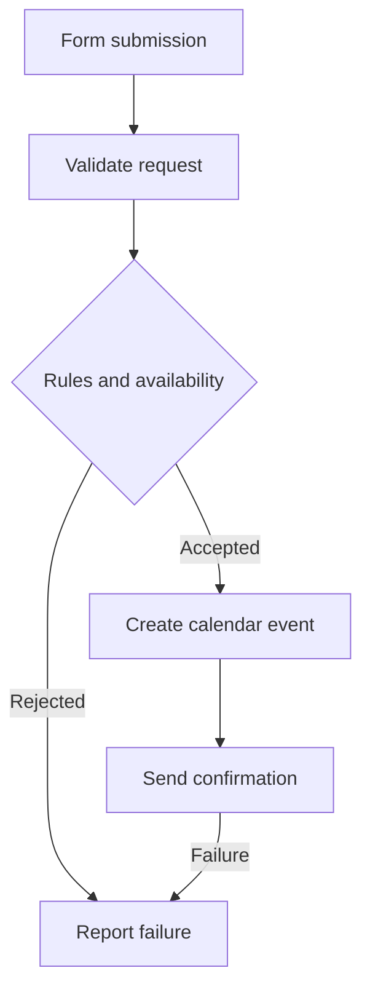

# Business Automation Systems
**Miangelisse Encarnacion**

## 1. Overview
Three operational automation projects address appointment intake, shared-room allocation, and repetitive spreadsheet reporting. This case study describes implementation patterns without client identities, operational records, or deployment configuration.

## 2. My Role
I translated operational requirements into workflow rules and implemented the scheduling, intake, and reporting logic. My work connected input collection, validation, processing, notifications, and usable outputs.

## 3. Technical Stack
Google Apps Script, Google Forms/Sheets submission workflows, CalendarApp, MailApp, LockService, PowerShell, and Microsoft Excel COM automation. The inspected scripts use built-in Apps Script services; a separate Gmail API integration is not claimed.

## 4. Architecture
The scheduling and intake tools use this event-driven pattern:

Calendar creation and email delivery are separate operations. A notification failure does not undo a calendar event.

The reporting tool runs separately on Windows: selected workbook inputs are read through Excel COM, aggregated in memory, and written to formatted workbooks. It is not a cloud-hosted reporting API.

## 5. Core Functionality
- **Resource scheduling:** Normalize form labels, parse requested times, apply buffers, check overlapping calendar events, try alternative rooms, recheck before creation, and send confirmations. A daily function groups assignments for summary emails.
- **Appointment intake:** Apply allowed-day/business-hour rules, check a slot-capacity limit, create a calendar entry, and send confirmation.
- **Annual reporting:** Aggregate billing/payment/balance amounts, outstanding balances by record identifier, and posted amounts by month; write three Excel outputs.

## 6. Challenges and Decisions
Apps Script kept form, spreadsheet, calendar, and mail operations in the same workspace. Script-level locking reduces races between cooperating trigger executions, while calendar availability is checked before a booking is written. This is not a global lock on external calendar edits.

Excel COM supports workbook operations in an existing Windows/Excel environment, with a portability tradeoff. Header-based lookup is used, but inconsistent schemas still require stronger validation.

## 7. Testing, Validation, and Reliability
Source inspection confirms validation branches, overlap checks, script locks, notifications, and aggregation routines. This portfolio review did not rerun production workflows or establish automated test results.

Important remaining reliability work includes request idempotency, notification-failure recovery, strict time validation, time-zone boundaries, and malformed-input checks. Future reliability work includes stronger workbook schema validation and guaranteed COM cleanup on failure.

## 8. Deployment Approach
Apps Script functions are intended for installed form-submission triggers, with a separate timed summary trigger where used. The reporting script requires Windows with desktop Excel and authorized local workbook access. Current production triggers, schedules, and execution logs were not independently verified in this review.

## 9. Verified Technical Outcomes
The inspected source implements room fallback allocation, intake capacity checks, automated calendar/mail operations, and three reporting outputs. No quantified time savings, elimination of all booking conflicts, guaranteed financial accuracy, or measured business impact is claimed.

## 10. Future Considerations
Add isolated tests with synthetic data, durable duplicate-request protection, stricter input/schema validation, minimized calendar descriptions, and explicit operational recovery. A cross-platform reporting library is a possible future change, not an implemented feature.

Commercial source and operational data remain private.
