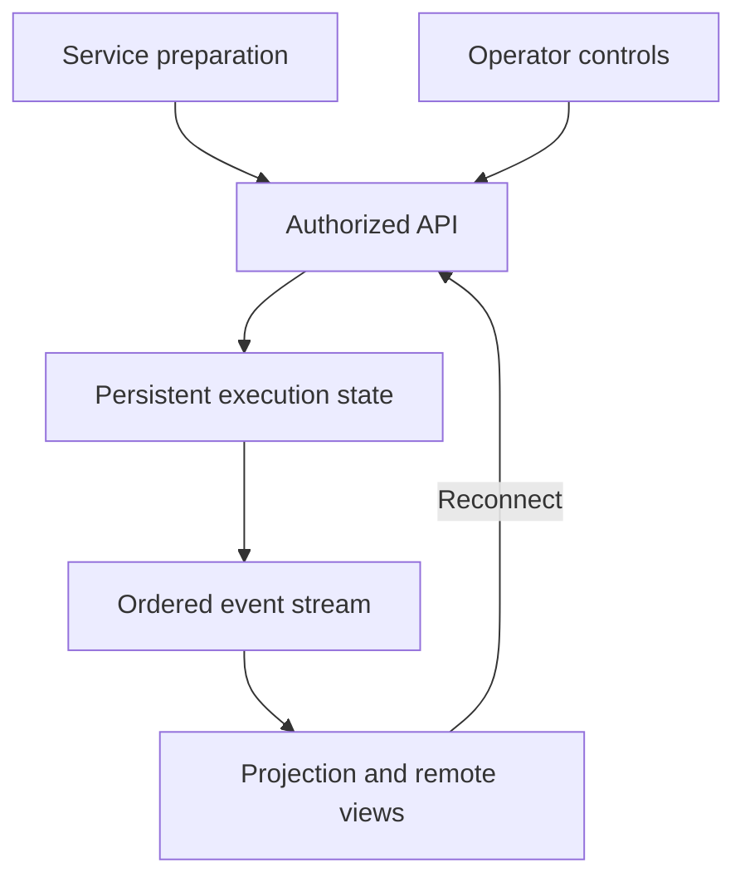

# Kairos Live — Real-Time Production Platform
**Miangelisse Encarnacion • Senior Engineering Project**  
English / Español

## English

### 1. Overview
Kairos Live is a full-stack platform for church production: preparing service content, operating presentations and projection, and coordinating technical cue workflows. Event management and CRM operations remain outside its scope.

### 2. My Role
I lead the project and own its product direction, requirements, systems integration, validation, and deployment work, collaborating with Jacob “Jake” Uzabel on the senior project.

### 3. Technical Stack
React, Vite, TypeScript, Node.js/Express, PostgreSQL, Drizzle, shared API contracts, Server-Sent Events, and a React Native/Expo remote. Render deployment configuration is present. Native build/transport evidence is separate from physical-device acceptance.

### 4. System Architecture

The server owns execution state. Preparing or previewing content is separate from sending it live.

### 5. Core Functionality
Implemented software and recorded development evidence cover scripture, songs, sermons, announcements, private media, service ordering, preview/live controls, and layered presentation. Production workflows include versioned review/approval, assignments and readiness.

Technical scene indicators and camera/audio/lighting cues support simulation. They are not proof of physical equipment control. Hosted mixed-service acceptance and deeper departmental adapters remain areas of ongoing development.

### 6. Engineering Decisions
Persistent state and ordered revisions support recovery instead of relying entirely on browser memory. Controller ownership and stale-command checks protect live operation. Separating prepared plans from the loaded live version helps keep edits from silently changing a running service. Read-only output views have different responsibilities from writable operator controls.

### 7. Testing and Reliability
Source includes command validation, revision conflict handling, controller checks, and stream replay/reset behavior. Historical development records describe tests and rehearsals for isolation, media, reconnection and recovery.

Those historical results were not rerun during portfolio preparation. Current authenticated hosted rehearsals, private-media acceptance and multi-operator recovery remain separate release checks. No guarantee of perfect synchronization or zero failures is claimed.

### 8. Deployment
The repository contains Render build/start scripts and an approach serving the web application and API from one origin with PostgreSQL and private media storage. This review did not certify the current hosted environment or perform a production release.

### 9. Verified Technical Outcomes
The inspected implementation establishes a full-stack service execution model, persistent snapshots, explicit preview/live commands and ordered state delivery. The current ledger distinguishes implemented software, historical development verification, simulations and outstanding acceptance.

Physical camera, mixer, lighting and projector integration; live external CRM connectivity; and safe multi-instance automatic advancement are not claimed as accepted.

### 10. Future Development
Complete hosted rehearsals, validate private media and device recovery, and implement departmental adapters in independently testable increments. Keep simulation clearly labeled and verify actual equipment separately.

Commercial source, church records, credentials and existing demo recordings are excluded.

Se excluyen el código comercial, los registros de la iglesia, las credenciales y las grabaciones existentes.
