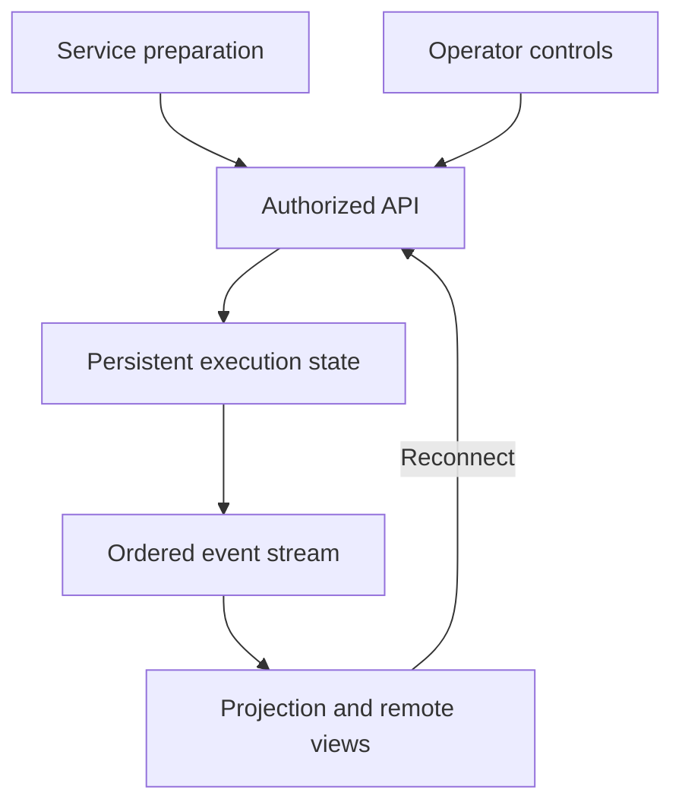

# Kairos Live — Real-Time Production Platform
**Miangelisse Encarnacion • Senior Engineering Project**  
English / Español

## English

### 1. Overview
Kairos Live is a full-stack platform for church production: preparing service content, operating presentations and projection, and coordinating technical cue workflows. Event management and CRM operations remain outside its scope.

### 2. My Role
I lead the project and own its product direction, requirements, systems integration, validation, and deployment work, collaborating with Jacob “Jake” Uzabel on the senior project.

### 3. Technical Stack
React, Vite, TypeScript, Node.js/Express, PostgreSQL, Drizzle, shared API contracts, Server-Sent Events, and a React Native/Expo remote. Render deployment configuration is present. Native build/transport evidence is separate from physical-device acceptance.

### 4. System Architecture

The server owns execution state. Preparing or previewing content is separate from sending it live.

### 5. Core Functionality
Implemented software and recorded development evidence cover scripture, songs, sermons, announcements, private media, service ordering, preview/live controls, and layered presentation. Production workflows include versioned review/approval, assignments and readiness.

Technical scene indicators and camera/audio/lighting cues support simulation. They are not proof of physical equipment control. Hosted mixed-service acceptance and deeper departmental adapters remain areas of ongoing development.

### 6. Engineering Decisions
Persistent state and ordered revisions support recovery instead of relying entirely on browser memory. Controller ownership and stale-command checks protect live operation. Separating prepared plans from the loaded live version helps keep edits from silently changing a running service. Read-only output views have different responsibilities from writable operator controls.

### 7. Testing and Reliability
Source includes command validation, revision conflict handling, controller checks, and stream replay/reset behavior. Historical development records describe tests and rehearsals for isolation, media, reconnection and recovery.

Those historical results were not rerun during portfolio preparation. Current authenticated hosted rehearsals, private-media acceptance and multi-operator recovery remain separate release checks. No guarantee of perfect synchronization or zero failures is claimed.

### 8. Deployment
The repository contains Render build/start scripts and an approach serving the web application and API from one origin with PostgreSQL and private media storage. This review did not certify the current hosted environment or perform a production release.

### 9. Verified Technical Outcomes
The inspected implementation establishes a full-stack service execution model, persistent snapshots, explicit preview/live commands and ordered state delivery. The current ledger distinguishes implemented software, historical development verification, simulations and outstanding acceptance.

Physical camera, mixer, lighting and projector integration; live external CRM connectivity; and safe multi-instance automatic advancement are not claimed as accepted.

### 10. Future Development
Complete hosted rehearsals, validate private media and device recovery, and implement departmental adapters in independently testable increments. Keep simulation clearly labeled and verify actual equipment separately.

Commercial source, church records, credentials and existing demo recordings are excluded.

## Español

### 1. Descripción
Kairos Live es una plataforma de producción para iglesias: preparación del servicio, presentaciones, proyección y coordinación de señales técnicas. La gestión de eventos y las operaciones de CRM quedan fuera de su alcance.

### 2. Mi Participación
Dirijo el proyecto y soy responsable de su dirección de producto, requisitos, integración, validación y despliegue, en colaboración con Jacob “Jake” Uzabel para el proyecto de último año. 

### 3. Tecnologías
React, Vite, TypeScript, Node.js/Express, PostgreSQL, Drizzle, contratos de API compartidos, Server-Sent Events y un control remoto con React Native/Expo. Existe configuración para Render. Las pruebas de compilación y transporte no equivalen a la aceptación de dispositivos físicos.

### 4. Arquitectura
La preparación y los controles del operador utilizan una API autorizada. El servidor conserva el estado de ejecución y entrega actualizaciones ordenadas a las vistas de proyección y control remoto. Preparar o previsualizar contenido no lo envía automáticamente a la pantalla del público.

### 5. Funciones
La implementación y la evidencia histórica de desarrollo incluyen Biblia, canciones, sermones, anuncios, medios privados, orden del servicio, controles de vista previa/en vivo y capas de presentación. Los procesos de producción incluyen revisión y aprobación por versión, asignaciones y preparación del equipo.

Los indicadores de cámaras, audio e iluminación sirven para simulaciones; no demuestran control de equipos físicos. La aceptación actual del servicio completo en el entorno alojado y los adaptadores departamentales siguen pendientes o parciales.

### 6. Decisiones Técnicas
El estado persistente y las revisiones ordenadas apoyan la recuperación. La propiedad del controlador y la validación de comandos desactualizados protegen la operación. Separar la preparación del contenido cargado en vivo evita que las ediciones cambien silenciosamente un servicio en ejecución. Las vistas del público son de solo lectura.

### 7. Pruebas y Confiabilidad
El código incluye validación de comandos, conflictos de revisión, controles de autorización y recuperación del flujo de eventos. Los registros históricos describen pruebas de aislamiento, medios, reconexión y recuperación.

Estas pruebas no se ejecutaron de nuevo durante la preparación del portafolio. Los ensayos autenticados actuales, los medios privados y la recuperación con varios operadores requieren aceptación independiente. No se promete sincronización perfecta ni ausencia total de fallas.

### 8. Despliegue
Existen scripts de compilación e inicio para Render y una arquitectura que sirve la aplicación web y la API desde un mismo origen, con PostgreSQL y almacenamiento privado. Esta revisión no certificó el entorno alojado actual ni publicó una versión de producción.

### 9. Resultados Verificados
Se inspeccionó un modelo completo de ejecución del servicio con estado persistente, comandos explícitos de vista previa/en vivo y entrega ordenada de actualizaciones. El registro actual distingue implementación, pruebas históricas, simulaciones y aceptación pendiente.

No se afirma aceptación de integración física con cámaras, mezcladoras, iluminación o proyectores; conexión a un CRM externo real; ni avance automático seguro entre varias instancias.

### 10. Próximos Pasos
Completar ensayos alojados, validar medios privados y recuperación, y desarrollar adaptadores por departamento con pruebas independientes. Mantener las simulaciones identificadas y verificar los equipos físicos por separado.

Se excluyen el código comercial, los registros de la iglesia, las credenciales y las grabaciones existentes.
