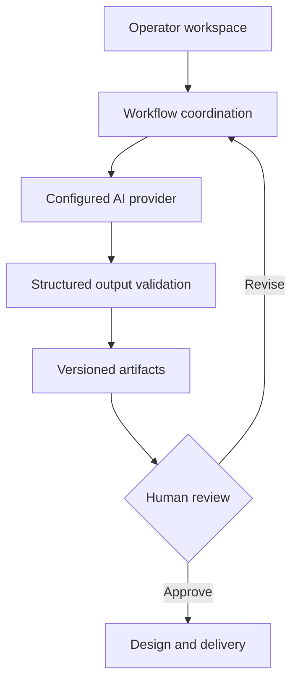

# Venge — AI Product Engineering
## 1. Overview
Venge is an AI-powered digital product development system. It coordinates research, product planning, content, design, review, and delivery through a staged workflow rather than treating generation as a single prompt.

## 2. My Role
I owned the original product builder's full engineering lifecycle: application development, AI integrations, workflow implementation, testing, debugging, deployment, and infrastructure. AI coding tools accelerated implementation; I remained responsible for requirements, architecture, code review, and validation.

## 3. Technical Stack
Next.js, React, TypeScript, Node.js, PostgreSQL, and HTTP APIs. Inspected source contains OpenAI integrations and a Google Vertex transport. Provider support in source does not establish which service is currently enabled or verified live.

## 4. Architecture

This is a conceptual architecture. Internal prompts, schema definitions, thresholds, private routing logic, and source code are excluded.

## 5. Core Functionality
The implementation separates product planning and generation from review, saved artifacts, design, and packaging. Source includes versioned workflow artifacts, recorded review decisions, product-specific workspaces, revision handling, persistence, and export-validation routines.

## 6. Challenges and Decisions
Model output is treated as a candidate artifact. Application rules enforce dependencies and review requirements; models generate or assess content within those boundaries. A review request and a saved approval are different states.

Versioned artifacts help preserve prior work and tie decisions to the reviewed output. Format-specific validation matters because readable generated text alone does not establish that a spreadsheet, presentation, or packaged file works.

The system uses staged LLM orchestration: deterministic application rules coordinate model-assisted work and explicit review.

## 7. Testing, Validation, and Reliability
Inspected tests cover provider dispatch boundaries, workflow gates, persistence, revision behavior, and generated-file checks. Validation routines reopen presentation/workbook artifacts and inspect relevant content or behavior.

This audit inspected definitions; it did not rerun the suites or verify every output format. Passing code tests alone would not establish finished-product quality or human acceptance.

## 8. Deployment Approach
The repository documents a Render deployment with an operator application, Node hosting/API layer, and dedicated PostgreSQL persistence. Current hosted readiness, active provider, database configuration, and deployment parity were not independently exercised during portfolio preparation.

## 9. Verified Technical Outcomes
Source establishes a full-stack application, multiple AI-provider transport paths, persistent versioned workflow handling, human-review gates, and output-validation code. Current performance, revenue, total test counts, and production acceptance are not claimed.

## 10. Future Considerations
Continue format-specific acceptance, evaluate provider behavior with controlled cases, improve recovery evidence, and verify current hosted workflows. Any expansion should retain explicit review decisions and reproducible validation.

Proprietary implementation, prompts, credentials, customer data, and internal business documents are excluded.
